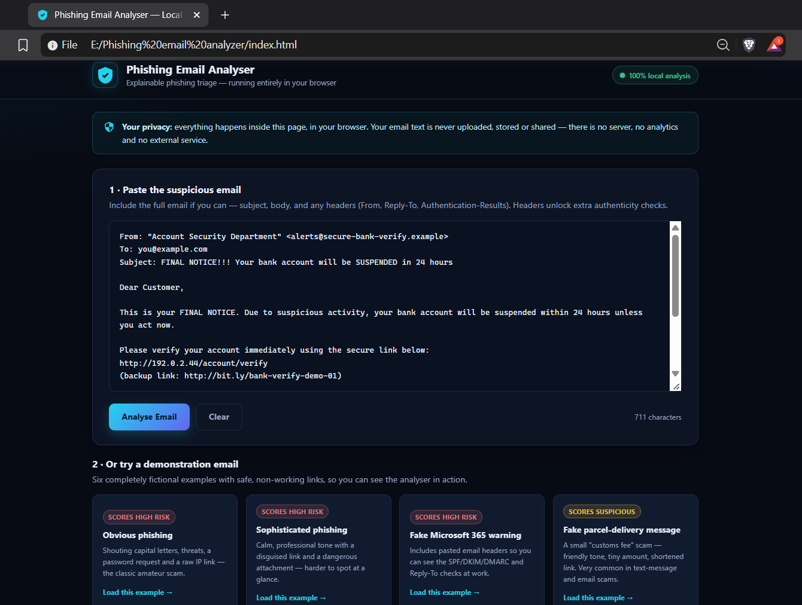
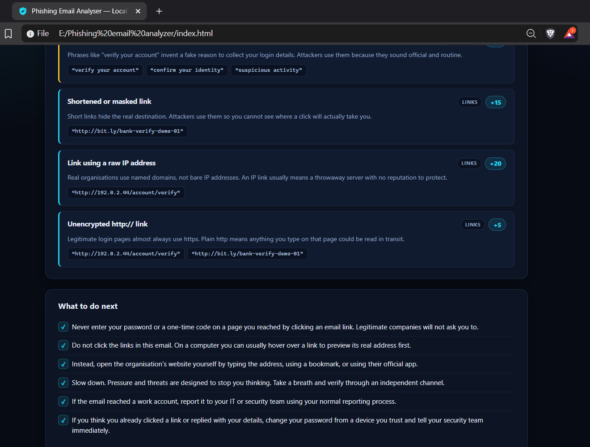

# Phishing Email Analyser

An educational, browser-based phishing email analysis tool built with HTML, CSS, and vanilla JavaScript. Paste a suspicious email to receive a **heuristic risk score (0–100)**, review detected warning signs with supporting evidence, and get practical recommendations.

The application is designed to analyse email text locally in your browser without requiring a backend or external analysis service.

## Live Demo

**Live application:** Replace this placeholder with your GitHub Pages URL after deployment.

`https://YOUR-USERNAME.github.io/phishing-email-analyser/`


## Screenshots

### Main Interface


### Analysis Results


### Recommendations



## Features

- **Local-first analysis:** Processes pasted email content in the browser.
- **Explainable risk scoring:** Shows triggered rules, point values, evidence, and explanations.
- **Risk classification:** Low Risk (0–29), Suspicious (30–69), and High Risk (70–100).
- **Email header analysis:** Checks supported sender, Reply-To, SPF, DKIM, and DMARC information when provided.
- **URL analysis:** Flags selected suspicious patterns, including shortened URLs, raw IP addresses, HTTP links, and misleading link formats.
- **Attachment filename indicators:** Detects selected executable extensions, deceptive double extensions, and potentially risky document patterns.
- **Social engineering detection:** Identifies selected urgency, threats, credential requests, payment requests, and impersonation-related language.
- **Actionable recommendations:** Provides safety guidance based on detected indicators.
- **Six fictional demo emails:** Explore example scenarios without using real victims' data.

## How It Works

The analyser uses predefined JavaScript rules to inspect email text, supported headers, URLs, and attachment filename patterns. Triggered rules contribute points to an overall score, which is capped at 100 and assigned a risk category.

| Category | Examples |
|---|---|
| Email content | Urgency, threats, credential requests, and verification-code requests |
| Links | Shorteners, raw IP addresses, selected suspicious domain endings, and HTTP links |
| Attachments | Selected executable extensions, double extensions, and macro-enabled document patterns |
| Email headers | Sender/Reply-To mismatches and supported SPF, DKIM, and DMARC results |

**Important:** The score is a heuristic indicator, not a probability or definitive verdict. A triggered rule does not independently prove that an email is malicious.

## How to Use

1. Open the live demo or download/clone this repository.
2. Open `index.html` in a modern web browser.
3. Paste an email, including available headers, or select a demo email.
4. Click **Analyse Email**.
5. Review the score, detected indicators, supporting evidence, and recommendations.

No package installation, build process, or backend server is required for basic use.

## Technology Stack

- **HTML5** — interface structure.
- **CSS3** — styling and responsive layout.
- **Vanilla JavaScript** — detection rules, scoring, parsing, and result rendering.

## Project Structure

```text
phishing-email-analyser/
├── index.html
├── styles.css
├── app.js
├── README.md
├── LICENSE
└── screenshots/
    └── app-preview.png   # Optional
```


## Privacy and Safe Use

The application is designed to process pasted email content locally in the browser. Its analysis code does not require a backend, database, or external analysis API.

For safer use:

- Prefer fictional, sanitised, or redacted email samples.
- Remove passwords, authentication tokens, personal information, and confidential data before analysis.
- Never click suspicious links or open suspicious attachments to test them.
- Verify unexpected requests through an organisation's official website, app, or a trusted contact method.

Review the published files and browser network activity before making stronger privacy guarantees.

## Limitations

This is an educational email-triage tool, not a production-grade email security gateway.

- **Heuristic detection:** It only detects patterns covered by its predefined rules.
- **False positives and negatives:** Legitimate emails may trigger warnings, while phishing emails may evade detection.
- **Simplified domain comparison:** Domain matching uses a basic last-two-label heuristic rather than comprehensive public-suffix-aware analysis.
- **Header limitations:** Pasted headers may be incomplete, forged, or interpreted incorrectly. Authentication results are not independently verified.
- **No live reputation checks:** The tool does not query external threat-intelligence services.
- **No actual attachment scanning:** It checks selected filename patterns in email text; it does not inspect attachment contents.
- **No definitive verdict:** A low score does not prove that an email is safe, and the score is not a calibrated probability.

## Learning Outcomes

This project demonstrates practical work with:

- Phishing indicators and social engineering patterns.
- Email header parsing and authentication-result interpretation.
- URL extraction and heuristic link analysis.
- Rule-based scoring and explainable detection.
- JavaScript DOM manipulation.
- Privacy-conscious application design.
- Security communication and risk guidance.

## Future Improvements

- More comprehensive email-header parsing.
- Public-suffix-aware domain comparison.
- Automated regression tests for detection rules and scoring.
- Additional fictional test cases and documented evaluation results.
- Optional report export with sensitive-data redaction.

## License

Licensed under the MIT License. See [LICENSE](LICENSE) for details.

## Author

**Samiha Tasnim**

Cybersecurity enthusiast focused on web application security, VAPT, authorised penetration testing, and security-focused development.
